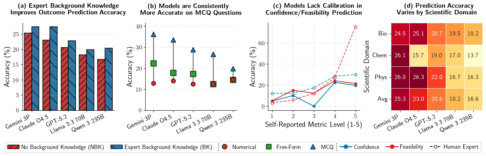

# SciPredict: Can LLMs Predict the Outcomes of Scientific Experiments in Natural Sciences?
SciPredict is a benchmark designed to assess whether Large Language Models can accurately predict the results of real-world scientific experiments in physics, biology, and chemistry without physical experimentation. Comprising 405 expert-curated questions derived from empirical scientific studies published after March 31, 2025, the dataset tests predictive reasoning over novel experimental setups rather than memorization. Our evaluation shows that while frontier models achieve accuracy comparable to human domain experts, they lack the critical calibration and self-awareness required for reliable deployment in scientific research.

<br>

Figure 1 summarizes our core findings. See the SciPredict [paper](https://arxiv.org/abs/xxxxxx) and [project page](https://scale.com/research/scipredict) for more details.

<figure>
    
    <figcaption>
        <strong>Key findings of SciPredict.</strong> Frontier models exhibit fundamental gaps in accuracy and calibration robustness in scientific experiment outcome prediction.
        We highlight four key failure modes using a representative subset of state-of-the-art models: Claude O4.5 (Claude Opus 4.5), OpenAI GPT-5.2, Gemini 3P (Gemini 3 Pro), Llama 3.3 (Meta Llama 3.3 70B), and Qwen 3 235B. <b>(a)</b> Providing expert-curated background knowledge (BK) as context for experiment outcome prediction consistently boosts performance over No Background Knowledge (NBK), suggesting models struggle to retrieve the required knowledge internally. <b>(b)</b> Accuracy generally degrades when moving from multiple-choice questions (MCQ) to questions requiring free-form answers (Free-Form) to Numerical value questions. <b>(c)</b> Unlike Human Experts (dahsed lines), models show poor calibration in SciPredict tasks; the accuracy of the models' answers to tasks do <u>not</u> correlate with their self-reported Confidence and perceived task prediction Feasibility. Both metrics are expected to have a <i>direct</i> correlation with accuracy. <b>(d)</b> SciPredict evaluates the accuracy of models predicting the outcome of scientific experiments in three domains of Biology, Chemistry, and Physics. Prediction accuracy is not uniform. The <i>Avg</i> field shown represents the weighted average of scores (weighted on the number of questions per domain), <u>not</u> the simple average of scores shown for the corresponding domains.
    </figcaption>
</figure>


<br><br><br>
This document outlines how to set up and run the various experimental pipelines for the SciPredict project. The system is built using Python and [Hydra](https://hydra.cc/) for flexible configuration management.

## Prerequisites

Before running any experiments, ensure you install the necessary dependencies and set up your environment:
```bash
pip install -r requirements.txt
```

**API Keys**: Create a `.env` (if non-existing) file in the root directory of the project and add API keys in the same format used  [here](https://github.com/scaleapi/propensity-evaluation).  

## Hydra Configuration

All experiments are managed through Hydra configuration files located in the `configs/` directory. (These are somewhat messy still in terms of how you should run them w/ the actual .py files, but they work for now.)

-   **`configs/conf.yaml`**: The main configuration file; sets default values for general fields.
-   **`configs/run/*.yaml`**: Specific config files (esp. for prompts and output schemas) for each experiment. **Importantly**, you have to provide the correct `key` in this config for the corresponding experiment to run as expected.

### Overriding Configuration using Command-Line Args

You can also run any experiment and change any setting from the command line without editing the YAML files. The basic structure is:

```bash
python <path_to_script.py> [setting.to.override1=value] [setting.to.override2=value]
```

Example:
```bash
python src/eval/main_qa_judge.py run.limit=10 run.input_predictions_path=...
```

---

## Data Files 
All data can be found under the `data/` directory. Please refer to the [data README](data/README.md) for details on the dataset structure and format.

---

## Running the Experiments

Below are the instructions for each major experimental workflow.

### Workflow 1: Initial Answer (Prediction) Generation

This is the primary experiment to have a model generate predictions for the questions in the dataset.

-   **Goal**: Generate model answers as well as confidence, difficulty, etc. ratings for questions.
-   **Script**: `src/eval/main_qa.py`
-   **Config Key**: Use `run.key=main_qa` for regular run and `run.key=main_qa_background` for run with provided background knowledge.
-   **Input**: `data.main` (defined in `configs/conf.yaml`)
-   **Output**: A `predictions.jsonl` file in the `output/` directory.

```bash
# Run with the default settings in configs/conf.yaml and configs/run/main_qa.yaml
python src/eval/main_qa.py run.key=...
```
---
### Workflow 2: Judging Generated Answers (Predictions)

This workflow evaluates the predictions generated in Workflow 1 against the ground truth.

-   **Goal**: Score MCQ/Numerical answers deterministically; run an LLM judge on free-form answers.
-   **Script**: `src/eval/main_qa_judge.py`
-   **Config Key**: Use `run.key=judge`.
-   **Input**: The `predictions.jsonl` file from Workflow 1. MUST use `run.input_predictions_path=...` to specify the path.
-   **Output**: A `judged_predictions.jsonl` file in the same directory as the input.

```bash
# You MUST provide the path to the predictions file from Workflow 1
python src/eval/main_qa_judge.py run.input_predictions_path="output/path/to/your/predictions.jsonl" run.key=...
```
---
### Workflow 3: Background Knowledge (BKG) Analysis Pipelines

This multi-step workflow analyzes the model's use of background knowledge. Use the generic `src/pipelines/generate_bkg.py` script for all steps.

#### Option 1: Generate Synthetic BKG Data
-   **Goal**: Have an LLM generate relevant background knowledge for each question.
-   **Config Key**: Use `run.key=generate_bkg`.
-   **Input**: `data.main` (the main dataset)
-   **Output**: A JSONL file containing a `generated_bkg` column.

```bash
python src/pipelines/generate_bkg.py run.key=...
```

#### Option 2: Convert BKG to Q&A
-   **Goal**: Convert the *original* background knowledge into a list of questions, one question per each original background knowledge item.
--   **Config Key**: Use `run.key=bkg_to_qa`.
-   **Input**: `data.main` (specifically the `required_background_knowledge_hashed` column)
-   **Output**: A JSONL file containing a `bkg_to_qa` list of question/hash objects.

**Command:**
```bash
python src/pipelines/generate_bkg.py run.key=...
```

#### Option 3: Answer, Judge, and Filter BKG
-   **Goal**: In a single run, answer the questions from Step B, have the model judge its own answers, and create a filtered list of BKG that the model answered incorrectly.
-   **Config Key**: Use `run.key=answer_and_judge_bkg_qa`.
-   **Input**: The JSONL output file from [Option 2](#option-2-convert-bkg-to-qa). MUST use `run.input_file=...` to specify the path.
-   **Output**: A JSONL file containing the answers to generated questions (Option 2) as well as the corresponding judgments.

**Command:**
```bash
python src/pipelines/generate_bkg.py run.input_file="output/path/to/bkg_to_qa_output.jsonl" run.key=...
```
---
### Workflow 4: MCQ to Free-Form Conversion and Evaluation

This workflow tests the model's ability on open-ended questions derived from the original MCQs.

-   **Goal**: Convert all MCQ-type questions into an open-ended format.
-   **Script**: `src/pipelines/convert_mcq_to_ff.py`
-   **Config Key**: Use `key=mcq_to_ff_convert`.
-   **Input**: `data.main` (the script automatically filters for MCQs)
-   **Output**: A JSONL file containing the original MCQ data plus a `free_form_question` field.

**Command:**
```bash
python src/pipelines/convert_mcq_to_ff.py run.key=...
```


## General Tips

-   **Testing**: You can use the `run.limit=<number>` override to test your changes on a small number of rows before running on the full dataset. For saving time and API costs if needed.
-   **Outputs**: All outputs are saved in the `output/` directory, organized by provider, experiment key, and model name. The outputs will be added to the output files as they are generated; you don't need to wait till the end of the runs to inspect results.